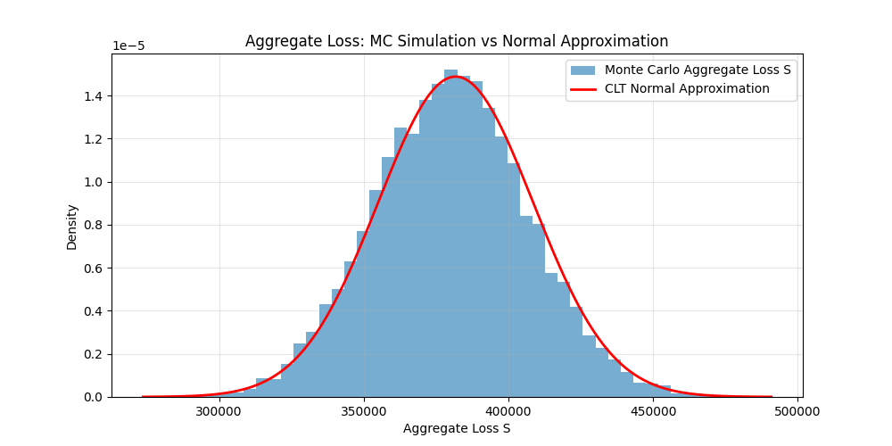
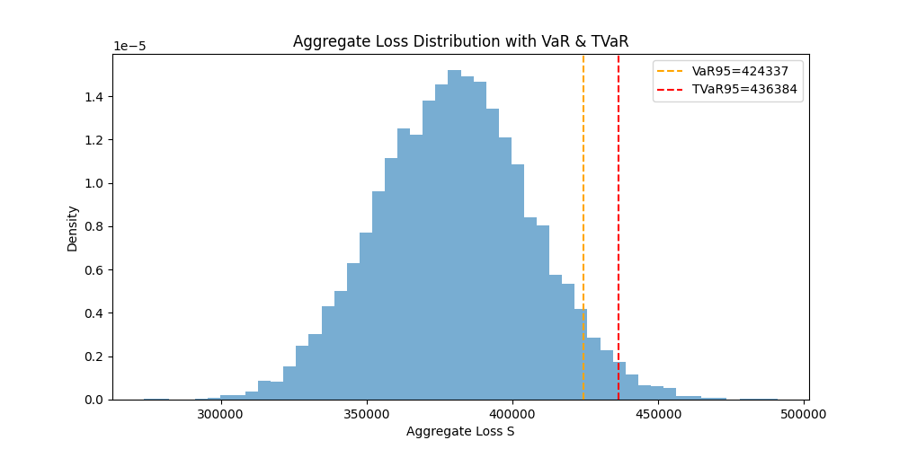

  # Non-Life Insurance Collective Risk Modelling (Frequency-Severity)
  This student actuarial project implements a compound Poisson collective risk model to evaluate the aggregate loss of a general insurance portfolio.
  
  ## Project Overview
  The total loss of an insurance portfolio is random: both the number of claims and individual claim sizes are stochastic.
  We use a compound Poisson model: claim count follows Poisson distribution, while claim severity follows the heavy-tailed Pareto distribution.
  An ordinary deductible and policy limit are applied to compute the insurer’s net claim payout. Monte Carlo simulation generates the aggregate loss distribution.
  
  ## Key Features
  1. Simulate insurance policies with risk covariates; claim frequency λ increases with policy risk score.
  2. Claim severity sampled from Pareto heavy-tailed distribution.
  3. Apply deductible and policy limit to calculate insurer’s actual payout Y.
  4. Monte Carlo simulation for aggregate loss S. Compare simulation results with CLT normal approximation.
  5. Compute stop-loss reinsurance premium, VaR 95% and TVaR 95% for solvency assessment.
  6. Auxiliary statistical methods:
      - Linear regression: predict claim severity by risk score
      - K-means clustering: group policies into three risk tiers
  7. Sensitivity analysis: examine how deductible level impacts expected aggregate loss and TVaR.
  
  ## Core Actuarial Formulas
  Aggregate loss: $S = Y_1+Y_2+\dots+Y_N,\quad N\sim\text{Poisson}(\lambda)$
  $E[S]=\lambda E[Y],\quad \text{Var}(S)=\lambda E[Y^2]$
  
  Payout function
  $$
  Y=
  \begin{cases}
  0 & X\le d \\
  X-d & d<X\le u \\
  u-d & X>u
  \end{cases}
  $$
  Stop-loss premium: $E[\max(S-a,0)]$
  TVaR: expected loss conditional on loss exceeding VaR
  
  ## Requirements
  `numpy, pandas, scipy, matplotlib, scikit-learn`
  
  ## How to Run
  ```bash
  pip install numpy scipy pandas matplotlib scikit-learn
  python collective_risk.py
  ```
  ## Outputs
  - Aggregate loss histogram vs CLT normal approximation
  
  - Loss distribution marked with VaR95 and TVaR95
  
  - Sensitivity plot: deductible’s impact on E[S] and TVaR95
  ![Sensitivity plot: deductible’s impact on E[S] and TVaR95](Figure_3.png)
  
  ## Assumptions & Limitations
  - Claims are assumed independent. In reality, catastrophe events can introduce claim correlation and raise portfolio risk.
  - Simulated policy data is used instead of real insurer claim data.
  - The Pareto distribution has a heavy tail, so CLT normal approximation underestimates extreme right-tail losses.
  - Pareto parameters are manually specified, not calibrated from real claim data.
  - Linear regression and K-means are auxiliary risk segmentation tools and not the core loss model.
  
  ## Conclusion
  This project demonstrates the frequency-severity framework for non-life insurance loss modelling. Heavy-tailed claim distribution makes normal approximation unsuitable for extreme risk evaluation. TVaR provides a more conservative measure of tail risk than VaR for solvency capital assessment.
